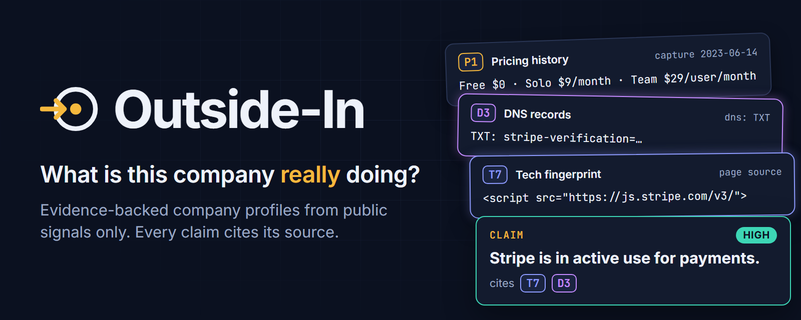
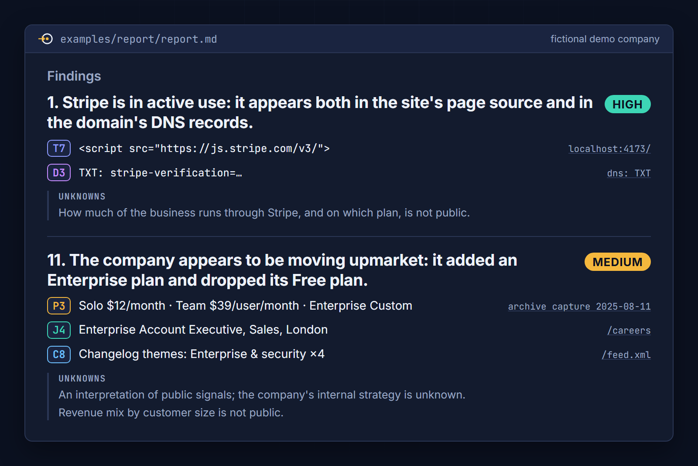
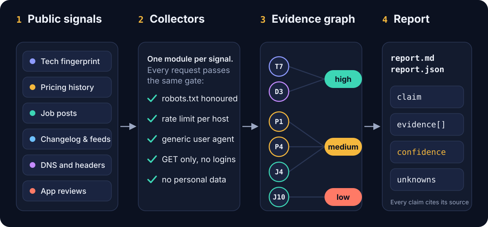
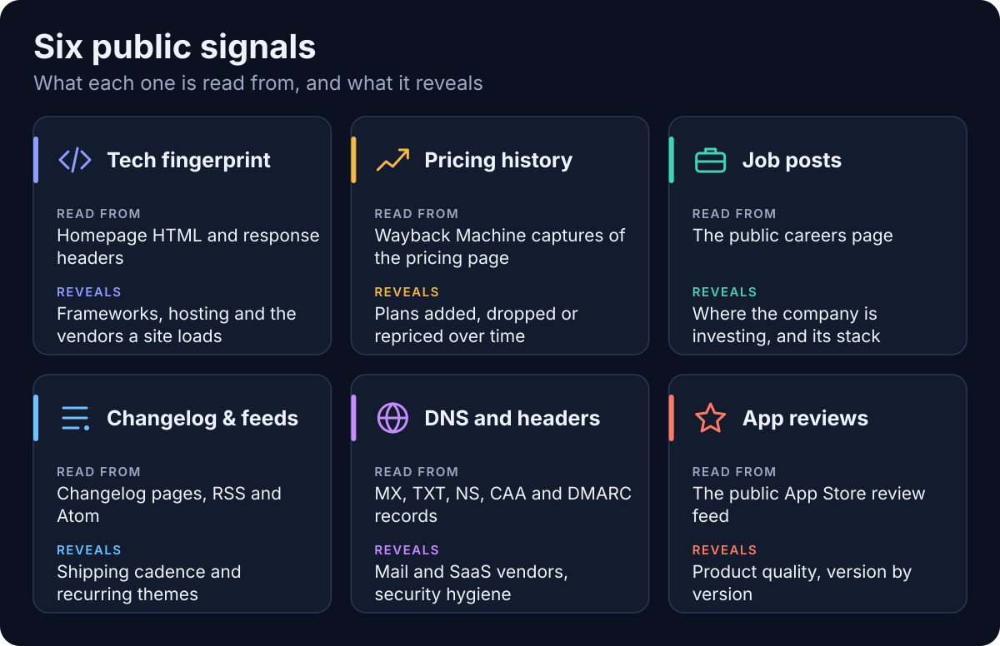
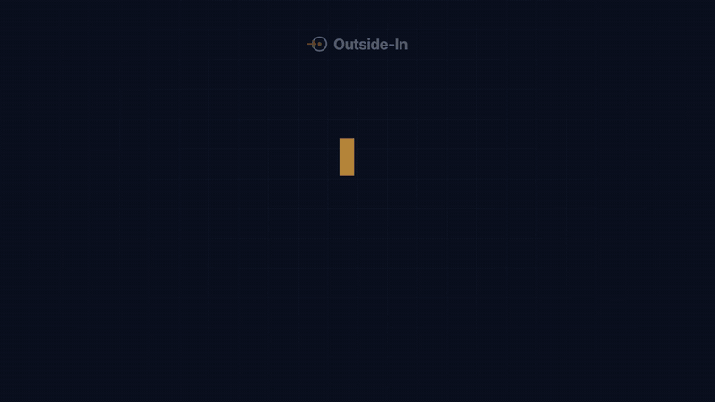

<p align="center">
  
</p>

# Outside-In

**What is this company really doing? Find out from the outside, with receipts.**

Outside-In builds an evidence-backed profile of any company from public signals only: the tech stack on its website, the history of its pricing page, its job posts, its changelog, its app reviews and its DNS records. Every claim in the report cites the source it rests on, carries a confidence level and lists what could not be established.

```bash
npx outside-in example.com
```

## Why

Company research usually ends in one of two places: a pile of browser tabs, or a confident paragraph from a model with nothing behind it. Neither is something you can hand to a colleague.

Outside-In takes a different position. Code collects the facts, and each fact becomes an evidence card with an id, a source URL, an excerpt and a timestamp. Only then does a model write findings, and it may only cite cards that exist. A finding whose citations cannot be verified is dropped. Confidence is computed from the evidence, not from how sure the sentence sounds.

The result reads like this:

<p align="center">
  
</p>

That is a styled rendering of two findings from the [example report](examples/report/report.md), which was generated against a fictional company served from this repository.

## How it works

<p align="center">
  
</p>

1. **Signals.** Six kinds of public information about a domain.
2. **Collectors.** One module per signal. All of them share a single HTTP client, so robots.txt, the rate limit and the user agent cannot be skipped by accident.
3. **Evidence graph.** Every observation is stored as an evidence item. Findings point at the items that support them.
4. **Report.** `report.md` for people and `report.json` for programs. Each finding has the shape `{ claim, evidence[], confidence, unknowns }`.

<p align="center">
  
</p>

### How confidence is assigned

| The claim is | Backed by | Confidence |
| --- | --- | --- |
| observed directly | two or more distinct sources | **high** |
| observed directly | one source | **medium** |
| an interpretation | two or more signal types | **medium** |
| an interpretation | one signal type | **low** |

When Claude writes the findings it proposes a level, and the code then caps it: a finding that rests on a single source can never be "high".

## Ethics and scope

Outside-In reads what a company has chosen to publish, and nothing else.

- **Public data only.** Every request is an unauthenticated `GET`. No cookies, no credentials, no forms.
- **Nothing behind a login.** A `401` or `403` is recorded as "out of scope" and never retried or worked around.
- **robots.txt is honoured.** It is fetched once per origin and checked before every page request, including each redirect hop. If a site's robots.txt disallows its pricing page, archived copies of that page are not read either. If robots.txt cannot be fetched because of a server error, the origin is treated as disallowed.
- **Every request is rate-limited.** Requests to one host run one at a time, at least 1.5 seconds apart by default, or slower if the site sets a `Crawl-delay`. A `429` or `503` is retried once, after waiting as instructed.
- **A generic user agent.** `outside-in/0.1 (public-signals research tool)`. It identifies the tool and never the person running it.
- **No personal data on employees.** The careers collector reads roles, not people. Reviewer names are never read from the review feed. E-mail addresses and phone numbers are redacted from every excerpt, and DNS verification tokens are truncated.
- **Unknowns are part of the output.** Each finding states what the evidence cannot establish, and the report lists everything that was skipped and why.

Documented public JSON APIs (the Wayback Machine CDX index, a DNS-over-HTTPS resolver and the App Store review feed) are rate-limited and identified in the same way. robots.txt governs the crawling of pages, so it is not consulted for those API calls.

This is a tool for understanding companies, not people. Please do not point it at individuals, and do respect the terms of the sites you profile.

## Install

Requires Node 22 or newer.

```bash
git clone https://github.com/hesselb20-ctrl/outside-in
```

```bash
cd outside-in
```

```bash
npm install
```

```bash
npm run build
```

## Quickstart

Profile a company:

```bash
npx outside-in example.com
```

This writes `outside-in-example.com/report.md` and `report.json`.

To have Claude (`claude-fable-5-2`) write the findings, set `ANTHROPIC_API_KEY` first. Without a key, or with `--no-llm`, the findings are written by deterministic offline rules instead, and the report says so.

Useful options:

| Option | What it does |
| --- | --- |
| `--only tech,dns` | Run a subset of: `tech`, `pricing`, `careers`, `changelog`, `dns`, `reviews` |
| `--app-id 1234567890` | Numeric App Store id; enables the reviews collector |
| `--max-snapshots 5` | How many archived pricing captures to compare |
| `--delay 3000` | Minimum milliseconds between requests to one host |
| `--no-llm` | Skip the Claude call |
| `--doh https://dns.google/resolve` | Resolve DNS over HTTPS instead of the system resolver |
| `--out ./reports/acme` | Output directory |
| `--json` | Print `report.json` to stdout |

Run `npx outside-in --help` for the full list.

### Try it offline against the demo company

The repository ships a fictional company, Tallybird, in [`examples/demo-site`](examples/demo-site). Its server also stands in for the archive, DNS and review services, so the whole pipeline runs locally and reproducibly.

```bash
npm run demo
```

That regenerates [`examples/report/report.md`](examples/report/report.md) and [`report.json`](examples/report/report.json): 13 findings from 45 pieces of evidence, across all six signals. The committed example was produced with the offline rules (`--no-llm`).

Run the tests, which exercise the same demo end to end:

```bash
npm test
```

## Use it from an agent (MCP)

The same collectors are exposed as an MCP server, so an agent can gather evidence itself and cite it.

Claude Code:

```bash
claude mcp add outside-in -- node /absolute/path/to/outside-in/mcp/dist/server.js
```

Any MCP client that takes a JSON config (Claude Desktop, Cursor and others):

```json
{
  "mcpServers": {
    "outside-in": {
      "command": "node",
      "args": ["/absolute/path/to/outside-in/mcp/dist/server.js"],
      "env": { "OUTSIDE_IN_DELAY_MS": "1500" }
    }
  }
}
```

Tools:

| Tool | Returns |
| --- | --- |
| `tech_fingerprint` | Frameworks, hosting, CDN and third-party tools seen in the homepage |
| `pricing_history` | Plans added, removed or repriced across archived captures |
| `careers` | Open roles by team and technologies named in job text |
| `changelog` | Entries, shipping cadence and recurring themes |
| `dns_records` | Mail, e-mail-sending and SaaS vendors revealed by DNS |
| `app_reviews` | Average rating, rating by version and complaint themes |
| `collect_all` | Every signal in one call, with one shared numbering of evidence ids |

Each tool returns `{ signal, ok, data, evidence[], unknowns[] }`. The server keeps one HTTP client for its whole lifetime, so the rate limit holds however quickly an agent calls it.

## Tutorial

<p align="center">
  <a href="media/tutorial.mp4"></a>
</p>

The preview above plays at double speed. The full 72-second version is [`media/tutorial.mp4`](media/tutorial.mp4) (1920x1080).

The video is code: a [Remotion](https://www.remotion.dev) project in [`tutorial/`](tutorial). The banner and the report image at the top of this page are stills from the same project, and the two diagrams are drawn by [`scripts/make-diagrams.mjs`](scripts/make-diagrams.mjs). All of them read one palette and type scale from [`design/tokens.json`](design/tokens.json). To re-render (needs `ffmpeg` on your PATH):

```bash
cd tutorial && npm install && npm run render
```

```bash
npm run media:diagrams
```

## Repository layout

```
cli/        the outside-in command and library: collectors, HTTP gate, synthesis, report
mcp/        MCP server exposing the collectors as tools
examples/   demo-site (a fictional company) and the report generated from it
tutorial/   Remotion project for the video and the PNG stills
scripts/    demo runner and SVG diagram generator
design/     shared colour and type tokens
media/      rendered images and video used in this README
```

## Limitations

- **It sees the marketing site, not the product.** The fingerprint is taken from the homepage. A logged-in app can run on a completely different stack.
- **No JavaScript is executed.** Prices, roles or changelog entries that only appear after client-side rendering are invisible to the parsers.
- **Pricing history depends on the Wayback Machine.** No captures means no history. archive.org also rate-limits and blocks some networks (VPN and datacentre ranges in particular); when that happens the report says so and falls back to the live page.
- **Parsers are heuristic.** Plan cards, job lists and HTML changelogs are recognised by common patterns. Unusual layouts will be missed, and a blog feed advertised on the homepage can be mistaken for a changelog.
- **Job boards are not followed.** Roles hosted on Greenhouse, Lever, Ashby and similar are detected but not fetched in this version.
- **Reviews cover one store and one storefront.** Apple's public feed only, most recent reviews only, and you supply the app id.
- **A signal is not a fact about intent.** A DNS record can outlive a contract. A job post can be evergreen. Treat "low" and "medium" findings as leads to check.
- **The Claude synthesis path has not been exercised in this repository's example.** The committed report was generated with the offline rules. The model call is typed against the current Anthropic SDK and its output is validated, but run it yourself before relying on it.

## Roadmap

- Follow public job-board APIs (Greenhouse, Lever, Ashby) where robots.txt allows
- Google Play reviews alongside the App Store
- Subdomain and status-page signals, GitHub organisation activity
- Optional headless rendering for JavaScript-only pricing pages
- Diff two reports of the same company over time
- Publish to npm so `npx outside-in` works without cloning

## License

[MIT](LICENSE)
