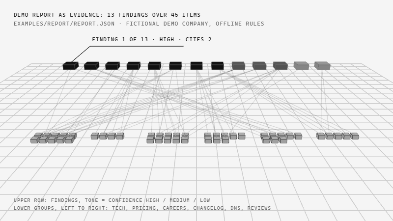

<picture>
  <source media="(max-width: 600px) and (prefers-color-scheme: dark)" srcset=".github/assets/hero-mobile-dark.svg">
  <source media="(max-width: 600px)" srcset=".github/assets/hero-mobile-light.svg">
  <source media="(prefers-color-scheme: dark)" srcset=".github/assets/hero-dark.svg">
  
</picture>

<picture>
  <source media="(max-width: 600px) and (prefers-color-scheme: dark)" srcset=".github/assets/rule-mobile-01-dark.svg">
  <source media="(max-width: 600px)" srcset=".github/assets/rule-mobile-01-light.svg">
  <source media="(prefers-color-scheme: dark)" srcset=".github/assets/rule-01-dark.svg">
  
</picture>

Outside-In builds a profile of a company from what it publishes: its website, its pricing page and
the archived copies of it, its job posts, its changelog, its DNS records and its App Store reviews.
Each statement in the report cites the evidence it rests on, carries a confidence level and lists
what the evidence cannot establish. It is a command-line tool, and the same collectors are also
offered to AI agents as an MCP server.

It is a prototype, version 0.1.0. It has been run end to end only against a fictional company served
from this repository. It is not published on npm.

<picture>
  <source media="(max-width: 600px) and (prefers-color-scheme: dark)" srcset=".github/assets/rule-mobile-02-dark.svg">
  <source media="(max-width: 600px)" srcset=".github/assets/rule-mobile-02-light.svg">
  <source media="(prefers-color-scheme: dark)" srcset=".github/assets/rule-02-dark.svg">
  
</picture>

**The problem.** Research on a company usually ends in a pile of browser tabs or in a confident
paragraph from a language model with no sources behind it. Neither can be handed to a colleague and
checked.

**What was missing.** A tool where code collects the facts first, each fact gets an id, a source URL
and an excerpt, and only then are findings written. A finding may only cite evidence that exists, and
its confidence comes from the evidence rather than from the wording.

**Who it is for.** Anyone who needs a quick, checkable picture of a company from the outside, and
agents that should cite their sources when they describe one. It reads only public pages. It is
meant for companies, not people.

<picture>
  <source media="(max-width: 600px) and (prefers-color-scheme: dark)" srcset=".github/assets/rule-mobile-03-dark.svg">
  <source media="(max-width: 600px)" srcset=".github/assets/rule-mobile-03-light.svg">
  <source media="(prefers-color-scheme: dark)" srcset=".github/assets/rule-03-dark.svg">
  
</picture>

<picture>
  <source media="(max-width: 600px) and (prefers-color-scheme: dark)" srcset=".github/assets/flow-mobile-dark.svg">
  <source media="(max-width: 600px)" srcset=".github/assets/flow-mobile-light.svg">
  <source media="(prefers-color-scheme: dark)" srcset=".github/assets/flow-dark.svg">
  
</picture>

1. **Domain in.** `outside-in <domain>` takes one domain. An App Store id is optional and switches on
   the reviews collector.
2. **Six collectors.** They run one after another, so evidence ids stay stable between runs. A
   collector that fails is recorded as an unknown and the others continue.
3. **One HTTP gate.** Every request goes through `PoliteHttp`. It sends unauthenticated `GET`s only,
   checks robots.txt before each page and each redirect, keeps at least 1.5 s between requests to one
   host (longer if `Crawl-delay` says so), and retries once on `429` or `503`. A `401`, `403` or `407`
   is logged as out of scope and never retried. If robots.txt fails with a server error, the origin is
   treated as disallowed.
4. **Evidence.** Each observation is stored with an id, a signal type, a source URL, an excerpt and a
   time. E-mail addresses and phone numbers are removed from excerpts. DNS verification tokens are
   cut off.
5. **Findings.** By default deterministic offline rules write them. When `ANTHROPIC_API_KEY` is set and
   `--no-llm` is not passed, Claude writes them instead. If that call fails, the offline rules take over
   and the report says so.
6. **Citation check.** Code removes any finding that cites no valid evidence id. The offline rules grade
   confidence from the evidence: a direct observation from two or more sources is high, from one source
   medium; an interpretation backed by two signal types is medium, by one signal low. For Claude's
   findings, code caps the grade so that one source can never give "high".
7. **Report.** `report.md` holds the summary, findings, what could not be established, an evidence table
   and the request log. `report.json` holds the same data for programs.

<picture>
  <source media="(prefers-color-scheme: dark)" srcset=".github/assets/scene-dark.gif">
  
</picture>

<sub>The committed example report on the fictional demo company, drawn from
[`examples/report/report.json`](examples/report/report.json): 45 evidence items grouped by collector, 13 findings
toned high, medium or low, and every citation line the report contains. Nothing is simulated; the layout and the
one-at-a-time lighting are for reading only.</sub>

<picture>
  <source media="(max-width: 600px) and (prefers-color-scheme: dark)" srcset=".github/assets/rule-mobile-04-dark.svg">
  <source media="(max-width: 600px)" srcset=".github/assets/rule-mobile-04-light.svg">
  <source media="(prefers-color-scheme: dark)" srcset=".github/assets/rule-04-dark.svg">
  
</picture>

What the code does today. All of it has been exercised only against the fictional demo company.

- **Tech fingerprint.** Frameworks, CMS, hosting, CDN and third-party tools matched in the homepage
  HTML and response headers, plus a check of five security headers. `cli/src/collectors/tech.ts`
- **Pricing history.** Archived captures of the pricing page from the Wayback Machine CDX index
  (5 by default), compared with the live page: plans added, removed or repriced. If robots.txt
  disallows the pricing page, archived copies are not read either. `cli/src/collectors/wayback.ts`
- **Job posts.** Roles by team and technologies named in job text, from structured data or job links
  on `/careers` and `/jobs`. Greenhouse, Lever and Ashby boards are detected but not fetched.
  `cli/src/collectors/careers.ts`
- **Changelog.** Entries, release cadence and recurring themes from a feed or an HTML changelog.
  `cli/src/collectors/changelog.ts`
- **DNS.** MX, TXT, NS, CAA and DMARC records mapped to mail, e-mail-sending and SaaS vendors, through
  the system resolver or a DNS-over-HTTPS endpoint (`--doh`). `cli/src/collectors/dns.ts`
- **App reviews.** Recent App Store reviews from Apple's public RSS feed: average, rating by version and
  complaint themes. Reviewer names are never read. Runs only with `--app-id`. `cli/src/collectors/reviews.ts`
- **Synthesis and report.** Offline rules or Claude, citation check, Markdown and JSON output.
  `cli/src/synthesize.ts`, `cli/src/report.ts`, `cli/src/cli.ts`
- **MCP server.** Seven tools over stdio: `tech_fingerprint`, `pricing_history`, `careers`, `changelog`,
  `dns_records`, `app_reviews` and `collect_all`. One HTTP client for the server's lifetime, so the rate
  limit holds across calls. `mcp/src/server.ts`
- **Demo company.** Tallybird, a fictional invoicing company. Its local server also stands in for the
  archive, DNS and review services, so the whole pipeline runs offline. `examples/demo-site`

Known limits, from the code and the previous README:

- It reads the marketing site, not the logged-in product.
- No JavaScript is executed. Content rendered in the browser is invisible to the parsers.
- Pricing history depends on the Wayback Machine having captures.
- Parsers are pattern-based. Unusual layouts will be missed.
- Reviews cover Apple's App Store only, one storefront, most recent reviews only.
- A signal is not proof of intent. Treat "low" and "medium" findings as leads to check.
- The Claude path has never been run in this repository. The committed example uses the offline rules.

<picture>
  <source media="(max-width: 600px) and (prefers-color-scheme: dark)" srcset=".github/assets/rule-mobile-05-dark.svg">
  <source media="(max-width: 600px)" srcset=".github/assets/rule-mobile-05-light.svg">
  <source media="(prefers-color-scheme: dark)" srcset=".github/assets/rule-05-dark.svg">
  
</picture>

Requires Node 22 or newer. The commands below were run on Windows 11 with Node 26.13.0 and npm 11.20.0.
macOS and Linux were not tested.

```bash
git clone https://github.com/hesselb20-ctrl/outside-in.git
cd outside-in
npm install
npm run build
```

Run the tests. Expect `pass 7`. They run against the local demo site; none touch the live network.

```bash
npm test
```

Profile the fictional demo company offline. Expect six `ok` lines and
`13 findings (8 high, 3 medium, 2 low) from 45 evidence items`. This rewrites
[`examples/report/report.md`](examples/report/report.md) and
[`examples/report/report.json`](examples/report/report.json) with new timestamps.

```bash
npm run demo
```

The package is not on npm. Inside a built clone the workspace links the command, so `npx` finds it.
Expect `0.1.0`, then the full option list.

```bash
npx --no-install outside-in --version
node cli/bin/outside-in.js --help
```

Not run here: profiling a real domain (`npx outside-in <domain>`), the Claude synthesis path, which needs
`ANTHROPIC_API_KEY`, and the MCP server (`node mcp/dist/server.js`). The option list is in
`--help`; the MCP tools are described in [`mcp/src/server.ts`](mcp/src/server.ts).

<picture>
  <source media="(max-width: 600px) and (prefers-color-scheme: dark)" srcset=".github/assets/rule-mobile-06-dark.svg">
  <source media="(max-width: 600px)" srcset=".github/assets/rule-mobile-06-light.svg">
  <source media="(prefers-color-scheme: dark)" srcset=".github/assets/rule-06-dark.svg">
  
</picture>

**Stack**

| Layer | Built with |
|---|---|
| CLI and library | TypeScript, Node 22+ ES modules, npm workspaces |
| Parsing | cheerio, fast-xml-parser |
| Synthesis | Offline rules; optional Anthropic SDK |
| MCP server | `@modelcontextprotocol/sdk`, zod, stdio transport |
| Tests | `node --test` against the local demo site |
| Tutorial video | Remotion project in `tutorial/` |

**Status**

| Part | State |
|---|---|
| Six collectors, HTTP gate, offline synthesis, report | Built. 7 tests pass. Run only against the fictional demo site. |
| Claude synthesis | Written and typed. Never run in this repository. |
| MCP server | Builds. Not run here. |
| Live company domains | Not tested in this repository. |
| Distribution | Not published on npm. No CI. |

**Roadmap.** As listed in the repository's previous README:

1. Follow public job-board APIs (Greenhouse, Lever, Ashby) where robots.txt allows.
2. Google Play reviews alongside the App Store.
3. Subdomain and status-page signals, GitHub organisation activity.
4. Optional headless rendering for pricing pages that need JavaScript.
5. Compare two reports of the same company over time.
6. Publish to npm so `npx outside-in` works without cloning.

**Documents**

| File | Contents |
|---|---|
| [`examples/report/report.md`](examples/report/report.md) | Full example report on the fictional company, offline rules |
| [`examples/demo-site/README.md`](examples/demo-site/README.md) | What the demo site serves and why |
| [`media/tutorial.mp4`](media/tutorial.mp4?raw=true) | 72-second explainer video, 1920x1080, 3.8 MB download |

<picture>
  <source media="(max-width: 600px) and (prefers-color-scheme: dark)" srcset=".github/assets/rule-mobile-07-dark.svg">
  <source media="(max-width: 600px)" srcset=".github/assets/rule-mobile-07-light.svg">
  <source media="(prefers-color-scheme: dark)" srcset=".github/assets/rule-07-dark.svg">
  
</picture>

MIT. See [`LICENSE`](LICENSE).

Respect the terms of the sites you profile. Do not point the tool at individuals.
